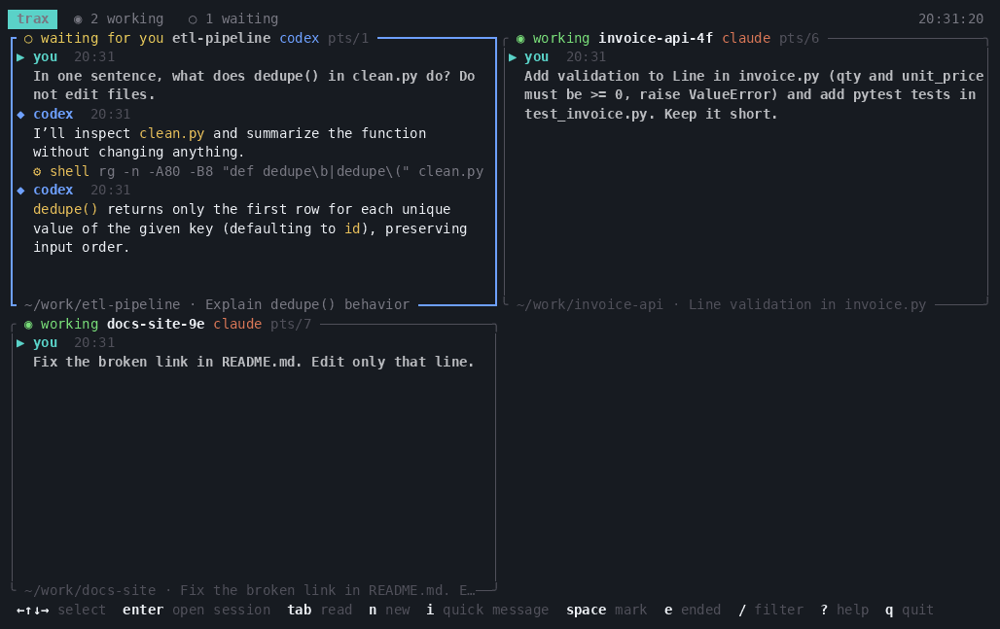

# trax

Watch and drive every coding-agent CLI session (Claude Code, Codex, Gemini, Aider, ...) from one terminal.



<sub>Real sessions, recorded in a throwaway folder: two Claude Code agents finish their tasks while Codex is taken over and given a new one.</sub>

```
trax                  # every session on one wall: select one, press Enter, you're in it
trax new claude       # start a session hosted by trax (full control)
trax take <session>   # move a session from another window into trax
```

## Install

Linux, x86_64 or arm64. Download the binary from the
[latest release](https://github.com/ielbadisy/trax/releases/latest):

```
curl -L https://github.com/ielbadisy/trax/releases/latest/download/trax-x86_64-unknown-linux-gnu.tar.gz | tar xz
install trax-x86_64-unknown-linux-gnu/trax ~/.local/bin/
```

Or build it with Cargo (Rust 1.88 or newer):

```
cargo install --git https://github.com/ielbadisy/trax
```

## What it does

- **Finds sessions by itself.** Any running `claude` or `codex` shows up with
  its folder, terminal, title and whether it is working or waiting for you.
  You don't have to change how you start them.
- **Reads the conversation, not the screen.** Messages come from the
  transcripts the agents already write (`~/.claude/projects`,
  `~/.codex/sessions`), so you see clean prompts, answers and tool calls.
- **Drives sessions started with `trax run`.** The wrapper is invisible in
  your own window. From trax you can then:
  - type a message (`i`) that lands exactly as if typed in that window,
  - send one message to several sessions (mark them with `space`, then `i`),
  - open it (`enter`): full keyboard control, `ctrl-q` to come back,
  - interrupt a turn (`x`),
  - mirror the real screen (`m`). This also works for agents with no
    transcript (gemini, aider, any CLI).
- **Tells you who needs you.** Each tile shows its state:
  `◉ working`, `○ waiting for you`, `● running`, `· ended`, and `✦ done` when
  it finished since you last looked. Inside a session, the top bar shows its
  state and flags `✦` when another session finishes, so you know when to
  press `ctrl-q` and go back.

- **Shows usage.** Each tile shows how full the context is and the tokens
  used so far (`ctx 72% · 1.2M tok`, yellow from 70%, red from 90%). The top
  bar shows your Codex plan limits: the 5-hour and weekly windows and when
  they reset (`codex 5h 9% · wk 1% ↻Mon 15:02`). Claude Code does not write
  its plan limits to its transcripts, so those are not shown yet.

- **Hosts sessions itself.** `trax new` (or `n` in the dashboard) starts an
  agent in the background, owned by trax: no window needed, full control.
- **Enter = be inside the session.** Select any session and press Enter: you
  get the agent's own full screen and prompt, as in its original window.
  `ctrl-q` comes back to the wall. A session running in another window is
  moved into trax on the way (Linux blocks typing into terminals you don't
  own): trax closes it there and reopens the same conversation here
  (`claude --resume` / `codex resume`). If it is mid-turn, trax waits for the
  turn to end (Enter again: now, Esc: cancel).
- **Full history.** The reader holds the whole conversation (scroll with the
  mouse wheel or PgUp/PgDn).

Tip: `alias claude='trax run claude'` keeps your own window and still lets
trax drive it.

## Commands

| command | |
|---|---|
| `trax` / `trax watch [-a] [--view focus]` | dashboard (`-a` adds sessions ended in the last 24h) |
| `trax ls [-a] [--json]` | list sessions |
| `trax show <session> [-f] [-n 20] [--detail 0-2]` | print a conversation, `-f` to follow |
| `trax send <session> <text...> [--no-enter]` | type into a `trax run` session |
| `trax screen <session>` | print a `trax run` session's current screen |
| `trax run <cmd> [args...]` | run any agent CLI in this window, drivable by trax |
| `trax new [-C dir] [-d] [cmd...]` | start a session hosted by trax (default `claude`), `-d` to stay detached |
| `trax take <session>` | move a session from another window into trax, keeping its conversation |
| `trax attach <session>` | open a trax session full screen (`ctrl-q` to leave) |

`<session>` is a pid, a tty (`pts/3`), a session-id prefix, or part of the
name, folder or title.

## Dashboard keys

| key | |
|---|---|
| arrows / hjkl, 1-9 | move between sessions |
| enter | open the session (ctrl-q back) |
| tab | wall ↔ reader |
| PgUp PgDn Home End, wheel | scroll the reader |
| t | detail: conversation → + tool calls → + tool output |
| e | include ended sessions |
| / | filter |
| i | quick message without opening it (Alt-Enter or ctrl-j for a new line) |
| space | mark sessions for a group message |
| x | interrupt (Esc) |
| n | new hosted session (`cmd @ folder`) |
| m | mirror real screens |
| ? | help |

## How it works

- Live processes come from `/proc`. Claude Code's `~/.claude/sessions/<pid>.json`
  gives the session id and busy/idle state. Codex is matched through the
  rollout file it holds open, or the newest rollout for its folder.
- `trax run` owns a pseudo-terminal, keeps a copy of the screen (vt100), and
  serves a small JSON protocol on `$XDG_RUNTIME_DIR/trax/<pid>.sock` (mode 0600):
  `send`, `keys`, `screen`, `resize`.
- `trax new` / take over run `trax run --headless` in its own process
  session (no terminal), so hosted agents survive the dashboard closing.
- `TRAX_ROOT=<folder>` limits trax to sessions under that folder (handy for
  demos and tests).

Linux only for now (uses `/proc`).

## Roadmap

- macOS support (finding processes without `/proc`).
- A desktop notification when a session finishes.
- Read Gemini and Aider conversations. Today they are listed, and shown as a
  screen copy when hosted by trax.
